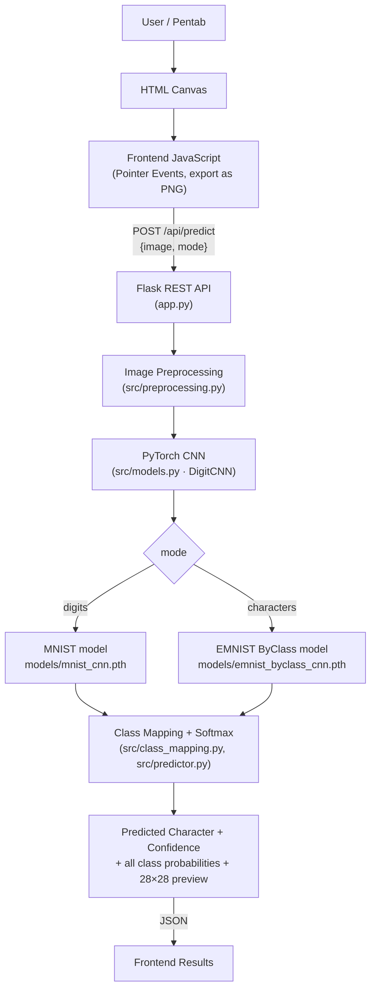

# Digit and Character Recognition System

*Developed by **Aakash Birla** and **Avadhesh Ransore** (Information Technology, 3rd Year) under the mentorship of
**Dr. Akhilesh Tiwari**, Department of Information Technology, MITS DU, Gwalior.*

An educational, end-to-end web application that recognises handwritten **digits (0–9)** and
**English letters (A–Z, a–z)** drawn in the browser with a **pen tablet, mouse or touchscreen**.
Draw a character, press **Predict**, and the page shows the model's prediction, its confidence,
the probability of every class, and the exact 28 × 28 image the neural network received.

**Live demo: <https://digit-character-recognition.onrender.com>** (hosted on Render's free plan: after
15 minutes without visitors the server sleeps, and the first request then takes about a minute).

* **Deep learning:** PyTorch only (no TensorFlow / Keras), trained on MNIST and EMNIST ByClass.
* **Backend:** Flask REST API (`/api/health`, `/api/predict`) with models loaded once at startup.
* **Frontend:** plain HTML5 + CSS3 + JavaScript (Canvas API, Pointer Events, Fetch API).

> The model's answer is a statistical guess. Confidence is the softmax probability of the
> predicted class, **not** a guarantee that the prediction is correct.

---

## Contents

1. [Features](#features)
2. [Installation and quick start](#installation-and-quick-start)
3. [Architecture](#architecture)
4. [Datasets: MNIST vs EMNIST ByClass](#datasets-mnist-vs-emnist-byclass)
5. [Class mappings](#class-mappings)
6. [Model architecture](#model-architecture)
7. [Training](#training)
8. [Evaluation and results](#evaluation-and-results)
9. [Image preprocessing](#image-preprocessing)
10. [Running the web application](#running-the-web-application-application-execution)
11. [Deployment (Docker and Render)](#deployment-docker-and-render)
12. [Pen tablet (pentab) support](#pen-tablet-pentab-support)
13. [REST API](#rest-api)
14. [Testing](#testing)
15. [GPU vs CPU](#gpu-vs-cpu)
16. [Project structure](#project-structure)
17. [Troubleshooting](#troubleshooting)
18. [Known limitations](#known-limitations)
19. [Dataset attribution and licensing](#dataset-attribution-and-licensing)
20. [Team and acknowledgements](#team-and-acknowledgements)

---

## Features

| Area | What you get |
|---|---|
| Two recognition modes | **Digits** (MNIST CNN, 10 classes) and **Characters** (EMNIST ByClass CNN, 62 classes: `0–9`, `A–Z`, `a–z`). Switching mode switches model and labels. |
| Drawing canvas | Black canvas, smooth round white strokes, brush-size slider, eraser toggle, undo, clear. Changing the brush or resizing the window never clears the drawing. |
| Input devices | Pen tablets (Wacom, Huion, XP-Pen, … via the browser's Pointer Events), mouse, touchscreen. Pen pressure changes the stroke width; the pen's eraser end erases; palm touches are ignored while the pen is in use. |
| Results | Predicted character and its type (digit / uppercase / lowercase), confidence, top-5 alternatives, probability bars for every class (searchable list plus a "Top 5 only" toggle for the 62 characters), processing time. |
| Transparency | A **"What the CNN sees"** preview of the preprocessed 28 × 28 input. |
| Model information | Dataset, number of classes, **measured** official test accuracy (only shown when it has been measured), validation accuracy, architecture, parameter count, inference device. |
| Status | Backend/model status indicator (online / degraded / offline). If a model is missing, the UI shows the command that trains it. |
| Design | Calm, responsive mint-and-teal interface: mint page (`#E7F3EE`), one teal accent (`#008178`) for the main action and the selected mode, flat cards tinted by purpose (`#EFF7F2` drawing, `#E2EFF8` prediction, `#F9F4E9` model information) with light tiles (`#F4F8FC`), dark-teal text (`#1C3D3A`), soft green / amber / red status pills, and a near-black drawing area with white strokes. Text meets WCAG AA contrast. |
| Engineering | Configurable training scripts with early stopping and checkpointing, evaluation script with full metrics and plots, dataset-verification script, 440+ pytest tests that need neither the datasets nor trained models. |

Keyboard shortcuts: <kbd>Enter</kbd> predict · <kbd>Esc</kbd> clear · <kbd>E</kbd> eraser ·
<kbd>[</kbd> / <kbd>]</kbd> brush size · <kbd>Ctrl</kbd>+<kbd>Z</kbd> undo.

---

## Installation and quick start

```bash
python3 -m venv .venv
source .venv/bin/activate
python -m pip install --upgrade pip
pip install -r requirements.txt        # see "GPU vs CPU" for CUDA wheels

python app.py                          # open http://127.0.0.1:5000
pytest -q                              # run the test suite
```

**Pre-trained models are included** (`models/mnist_cnn.pth`, `models/emnist_byclass_cnn.pth`,
~1.7 MB each, with the measured results below), so the app works right after installation.
To reproduce them, or after changing the code, retrain:

```bash
python train_mnist.py --epochs 10      # digits model     -> models/mnist_cnn.pth
python train_emnist.py --epochs 15     # characters model -> models/emnist_byclass_cnn.pth
```

The datasets are downloaded automatically into `data/` on first use (MNIST ≈ 11 MB,
EMNIST ≈ 562 MB zip, ≈ 2.2 GB extracted).

---

## Architecture



| Module | Responsibility |
|---|---|
| `src/config.py` | Paths and one `DatasetSpec` per dataset (classes, mean/std, orientation, glyph geometry). |
| `src/class_mapping.py` | Verified class-index → character tables for MNIST and EMNIST ByClass. |
| `src/models.py` | `DigitCNN(num_classes=…)`, the configurable CNN. |
| `src/datasets.py` | torchvision download/loading, orientation fix, train/validation split, fast in-memory batch loader, GPU augmentation, sample grids. |
| `src/training.py` | Training loop, early stopping, checkpointing, history and plots (used by `train_mnist.py` / `train_emnist.py`). |
| `src/evaluation.py` | Test-set metrics, confusion matrix, classification report, canvas round-trip check (used by `evaluate.py`). |
| `src/checkpoints.py` | Safe `state_dict` checkpoints with metadata (`torch.load(..., weights_only=True)`). |
| `src/preprocessing.py` | Canvas image → normalised `(1, 1, 28, 28)` tensor. |
| `src/predictor.py` | Loads both models once, runs inference, reports model status. |
| `app.py` | Flask app factory, REST API, static frontend, CLI. |
| `frontend/` | `index.html`, `styles.css`, `script.js`. |

---

## Datasets: MNIST vs EMNIST ByClass

| | MNIST | EMNIST ByClass |
|---|---|---|
| Used for | Digit mode | Character mode |
| Classes | 10 (`0`–`9`) | 62 (`0`–`9`, `A`–`Z`, `a`–`z`) |
| Official train / test | 60,000 / 10,000 | 697,932 / 116,323 |
| Validation set (this project) | 6,000 (10 % of the **train** split, seeded) | 69,793 (10 % of the **train** split, seeded) |
| Class balance | roughly balanced (5,421 – 6,742 per class) | very imbalanced (1,896 `j` … 38,374 `1`; digits ≈ 49 %) |
| Raw orientation in torchvision | upright | **transposed** – fixed with one `transpose(1, 2)` |
| Pixel mean / std (train) | 0.1307 / 0.3081 | 0.1736 / 0.3317 |
| Glyph size in the 28 × 28 frame | longest side 20 px | longest side ≈ 24 px (incl. blur halo) |
| Centring convention | intensity centre of mass at (14, 14) | bounding-box centre at (13.5, 13.5) |
| Median stroke width | ≈ 2.4 px | ≈ 2.8 px |

All numbers above were **measured on the downloaded data** by `inspect_datasets.py`, which
writes `results/dataset_inspection.json` and sample grids:

* `results/samples_mnist.png` – MNIST samples with their labels.
* `results/samples_emnist_byclass.png` – EMNIST samples after the orientation fix (upright, labels match).
* `results/samples_emnist_byclass_raw_untransposed.png` – the raw torchvision tensors, for comparison.

**Orientation.** Raw EMNIST tensors from `torchvision.datasets.EMNIST` are stored with rows and
columns swapped. The fix lives in exactly one place, `src.datasets.to_upright`, and is a single
transpose (no extra flip or rotation). It was verified visually (sample grids) and automatically
(`inspect_datasets.py` classifies EMNIST digits with MNIST class templates in 7 orientations;
upright wins clearly; a pytest check does the same when the data is present). Training,
evaluation and inference all use upright images, so drawings are never rotated at inference time.

The official test splits are **never** used for training, validation or model selection; they
are loaded only after training to evaluate the best checkpoint.

---

## Class mappings

**MNIST:** class index *i* → digit `str(i)`.

**EMNIST ByClass** (verified against the official `emnist-byclass-mapping.txt` inside
`data/EMNIST/raw/gzip.zip` *and* against `torchvision.datasets.EMNIST(...).classes`):

| Class indices | Characters | ASCII codes in the official mapping |
|---|---|---|
| 0 – 9 | `0`–`9` | 48 – 57 |
| 10 – 35 | `A`–`Z` | 65 – 90 |
| 36 – 61 | `a`–`z` | 97 – 122 |

The class index is **not** the ASCII code (e.g. class 10 → ASCII 65 → `A`). The tables live in
`src/class_mapping.py`; checkpoints also store the label list, and the predictor refuses a
checkpoint whose labels do not match.

---

## Model architecture

`DigitCNN` (`src/models.py`) – the same architecture for both datasets, only the number of
outputs differs (`DigitCNN(num_classes=10)` / `DigitCNN(num_classes=62)`):

```
Input 1×28×28
 → Conv2d(1→32, 3×3, padding 1) → BatchNorm → ReLU → MaxPool 2×2      # 32×14×14
 → Conv2d(32→64, 3×3, padding 1) → BatchNorm → ReLU → MaxPool 2×2     # 64×7×7
 → Flatten (3136) → Linear(3136→128) → ReLU → Dropout(0.3)
 → Linear(128→num_classes)                                             # raw logits
```

| Model | Parameters |
|---|---|
| MNIST (10 classes) | 421,738 |
| EMNIST ByClass (62 classes) | 428,446 |

The network outputs **raw logits** (training uses `CrossEntropyLoss`); softmax is applied only
at inference/evaluation time. BatchNorm (an addition to the minimal Conv → ReLU → Pool design)
stabilises training; it can be disabled with `DigitCNN(..., batch_norm=False)`.

**Checkpoints** (`models/*.pth`) are dictionaries containing the `model_state_dict` plus
metadata: architecture config, number of classes, dataset id, class labels and mapping version,
the preprocessing configuration, the training configuration (epochs, batch size, learning rate,
augmentation, seed, device, …), validation metrics, best epoch and – once measured – the
official test metrics. They are loaded with `torch.load(..., map_location=..., weights_only=True)`
(supported since PyTorch 1.13, default since 2.6), so a GPU-trained checkpoint loads on a CPU-only
machine and no arbitrary pickled code is executed.

---

## Training

```bash
python train_mnist.py --epochs 10           # defaults: batch 128, lr 1e-3
python train_emnist.py --epochs 15          # defaults: batch 256, lr 1e-3
```

What a training run does:

1. Loads (and if needed downloads) the official **train** split and validates image shape,
   dtype and label range.
2. Holds out a seeded 10 % validation subset of the train split.
3. Trains `DigitCNN` with `CrossEntropyLoss` and Adam; light random affine augmentation
   (±10° rotation, 0.9–1.1 scale, small shear/translation, done on the GPU) is applied to
   training batches only.
4. Tracks train/validation loss and accuracy each epoch; `ReduceLROnPlateau` halves the
   learning rate when validation accuracy stalls; **early stopping** after `--patience` epochs
   without improvement.
5. Saves the **best checkpoint by validation accuracy**, `history.json` and
   `training_curves.png`.
6. Reloads the best checkpoint and evaluates it **once** on the untouched official test split,
   writes all metrics to `results/<dataset>/` and stores a compact copy in the checkpoint.

Common options (both scripts; `python train_mnist.py --help` lists all):

| Option | Meaning |
|---|---|
| `--epochs N` | maximum number of epochs |
| `--batch-size N` | training batch size |
| `--lr X` | Adam learning rate |
| `--weight-decay X` | Adam weight decay |
| `--data-dir PATH` | dataset location (default `data/`) |
| `--output PATH` | checkpoint path (default `models/mnist_cnn.pth` / `models/emnist_byclass_cnn.pth`) |
| `--results-dir PATH` | where history, plots and metrics go (default `results/<dataset>/`) |
| `--device {auto,cpu,cuda}` | `auto` = CUDA if available, else CPU |
| `--val-fraction X` | validation share of the train split (default 0.1) |
| `--patience N` | early-stopping patience (0 disables) |
| `--seed N` | seed for weights, split, shuffling and augmentation |
| `--deterministic` | bit-reproducible GPU training for a given seed (slightly slower; CPU runs are always reproducible) |
| `--no-augment` | disable augmentation |
| `--balanced-loss` | weight the loss by inverse √(class frequency) (see [Known limitations](#known-limitations)) |
| `--max-train-samples N`, `--max-test-samples N` | small subsets for quick smoke tests (partial test results are never stored as test accuracy) |

A run with a custom `--output` and no `--results-dir` writes its history, plots and metrics to
`<output folder>/<output name>_results/`, so smoke tests never overwrite `results/<dataset>/`.
| `--roundtrip-samples N` | number of simulated canvas drawings for the preprocessing check (default 2000, 0 = skip) |

Quick smoke test (seconds):

```bash
python train_mnist.py --epochs 1 --max-train-samples 3000 --max-test-samples 1000 \
    --output /tmp/smoke.pth --results-dir /tmp/smoke --roundtrip-samples 0
```

---

## Evaluation and results

```bash
python evaluate.py                       # both models (skips a missing checkpoint)
python evaluate.py --mode digits         # or: --mode characters
python evaluate.py --mode characters --checkpoint models/emnist_byclass_cnn.pth
```

`--max-test-samples N` evaluates a seeded subset for a quick check; those results go to
`results/<dataset>/subset/` and are never stored in the checkpoint as test accuracy.

For each model `results/<dataset>/` contains:

| File | Content |
|---|---|
| `test_metrics.json` | accuracy, loss, macro/weighted precision, recall, F1, per-class metrics, confusion matrix, classes never predicted, top confusions |
| `classification_report.txt` | scikit-learn classification report with character labels (`zero_division=0`, so never-predicted classes are handled) |
| `per_class_metrics.csv` | precision / recall / F1 / support / predicted count per class |
| `confusion_matrix.png`, `confusion_matrix.csv` | confusion matrix (rows = true class; row-normalised colours, all 62 labels shown for EMNIST) |
| `history.json`, `training_curves.png` | per-epoch train/validation loss and accuracy (written by training) |
| `roundtrip.json` | canvas round-trip check (see below) |

**Canvas round-trip check.** To test the *preprocessing* (not just the model), 2,000 official
test images are re-drawn as crisp strokes at a random size and position on a 400 × 400 black
canvas, passed through the exact preprocessing the web app uses, and classified. If this
accuracy is close to the accuracy on the original images, the preprocessing reproduces the
training-data conventions well.

### Measured results

Measured on **2026-10-29** with the commands in [Installation and quick start](#installation-and-quick-start) (PyTorch 2.14.0,
NVIDIA GeForce RTX 3050 Laptop GPU). Your numbers will vary slightly with hardware and seeds.

| | MNIST (digits) | EMNIST ByClass (characters) |
|---|---|---|
| Epochs run / best epoch | 10 / 10 | 15 / 13 |
| Training time (GPU) | 21 s | 4 min 48 s |
| Best validation accuracy | 99.43 % | 85.79 % |
| **Official test accuracy** | **99.31 %** (10,000 images) | **85.82 %** (116,323 images) |
| Test loss | 0.0201 | 0.3815 |
| Macro precision / recall / F1 | 0.9931 / 0.9931 / 0.9931 | 0.7747 / 0.7230 / 0.7152 |
| Weighted F1 | 0.9931 | 0.8404 |
| Accuracy ignoring letter case | – | 89.92 % |
| Canvas round-trip accuracy (2,000 drawings) | 99.30 % (same images, original: 99.55 %) | 85.00 % (same images, original: 85.75 %) |

Most frequent EMNIST confusions: `O→0`, `l→1`, `I→1`, `1→l`, `m→M` – characters that are
genuinely ambiguous in handwriting. Lowercase `c` and `o` are never predicted (their uppercase
forms look identical and are more frequent). See [Known limitations](#known-limitations).

---

## Image preprocessing

The canvas (400 × 400, any brush size, glyph anywhere) looks nothing like a dataset sample, so
`src/preprocessing.py` rebuilds the dataset conventions measured above. The same pipeline
serves both models; only its parameters differ:

1. **Decode & validate** the PNG/JPEG/WEBP/BMP/GIF (format whitelist, size limits checked before
   decoding pixels, decompression-bomb protection).
2. **Grayscale, white ink on black**: strokes on a transparent background are composited onto
   black (transparent margins of an opaque page take the page colour); light backgrounds are
   inverted only when both the border and the whole image are light, so a drawing whose strokes
   touch the canvas edges is never inverted; the background level is removed.
3. **Detect the ink**, reject blank canvases (`blank_canvas`), drop isolated specks.
4. **Crop** to the ink bounding box.
5. **Normalise the stroke width** conservatively (thin pen strokes are thickened, very thick
   brush strokes gently thinned), with guards that never merge strokes, close/open loops, or
   empty the image.
6. **Resize** so the longest side is **20 px (MNIST) / 23 px (EMNIST)** with one scale factor
   for both axes – the aspect ratio is preserved; glyphs are never stretched to 28 × 28.
7. **Place** in a 28 × 28 frame: MNIST → centre of mass at (14, 14); EMNIST → bounding-box centre
   at (13.5, 13.5).
8. **Normalise** with the dataset mean/std stored in the checkpoint → tensor `(1, 1, 28, 28)`.

Why 23 px for EMNIST when the data measures 24 px? EMNIST's 24 px includes the soft halo of the
Gaussian blur applied when the dataset was built; crisp canvas strokes have no halo. A sweep with
the trained model on 4,000 simulated drawings of **validation** images (the held-out part of the
train split, never the test split), each in three stroke styles, gave a mean accuracy of 82.1 % at
24 px, 84.2 % at 23 px and 83.1 % at 22 px, so 23 px is used. For MNIST, 19/20/21 px were
equivalent (99.2 %), so the dataset's own 20 px convention is kept.

The preview in the UI shows the 28 × 28 result. `python app.py --debug-preprocessing` also saves
every preprocessed input to `results/debug/latest_<mode>.png`.

---

## Running the web application (application execution)

```bash
python app.py                                  # http://127.0.0.1:5000
python app.py --port 8000 --device cpu         # force CPU inference
python app.py --host 0.0.0.0                   # reachable from other devices on your network (e.g. a tablet)
```

| Option | Meaning |
|---|---|
| `--host`, `--port` | bind address (default `127.0.0.1:5000`) |
| `--device {auto,cpu,cuda}` | inference device (default `auto`) |
| `--mnist-checkpoint PATH`, `--emnist-checkpoint PATH` | use other checkpoints |
| `--debug-preprocessing` | save preprocessed inputs to `results/debug/` |
| `--debug` | Flask debug mode (development only) |

Both checkpoints are loaded **once at startup**. If one is missing or broken the app still starts:
`/api/health` reports `degraded`, that mode returns HTTP 503 with the command that trains it, and
the UI disables Predict for that mode. `app.py` uses Flask's development server, which is fine
locally; for a public deployment run `create_app()` under a production WSGI server (see
[Deployment](#deployment-docker-and-render)).

---

## Deployment (Docker and Render)

The live demo runs the [`Dockerfile`](Dockerfile) on [Render](https://render.com)'s free plan.
The image contains only what the app needs at run time:

* **CPU-only PyTorch** (about 0.8 GB installed instead of several GB for the CUDA build) plus the
  packages in [`requirements-deploy.txt`](requirements-deploy.txt); torchvision, scikit-learn,
  matplotlib and pytest are only used for training and testing.
* `app.py`, `src/`, `frontend/` and the two checkpoints in `models/`; [`.dockerignore`](.dockerignore)
  keeps the datasets, results and reports out.
* **gunicorn** serves `create_app()` with one worker (one copy of the models in memory) and four
  threads, listening on `$PORT` when the host sets it (default 7860). One math thread
  (`OMP_NUM_THREADS=1`) suits the small CPU share of free plans. The app uses about 310 MB of RAM.

**Deploy your own copy on Render:** in the Render dashboard choose **New → Blueprint** and select
this repository. [`render.yaml`](render.yaml) creates a free web service (Docker, Singapore region,
health check on `/api/health`) that redeploys on every push to `main`. The free plan sleeps after
15 minutes without traffic and needs about a minute to wake up.

**Run the same image locally** (any Docker host):

```bash
docker build -t digit-recognition .
docker run --rm -p 7860:7860 digit-recognition   # http://127.0.0.1:7860
```

---

## Pen tablet (pentab) support

Drawing uses the browser's standard **Pointer Events API**, so any tablet whose driver works in
the browser (Wacom, Huion, XP-Pen, Gaomon, …) works without a vendor SDK:

* `pointerdown` / `pointermove` / `pointerup` / `pointercancel` with **pointer capture**, so a
  stroke continues even if the pen leaves the canvas.
* **Coalesced events** (`getCoalescedEvents`) for smooth, high-frequency pen input.
* **Pressure**: for `pointerType === "pen"`, stroke width = brush × (0.35 + 0.65 × pressure), with
  a minimum width, so pens that report little or no pressure still draw visible strokes. Mouse and
  touch use the constant brush width.
* The pen's **eraser end** (button 5) erases automatically.
* **Palm rejection**: touch input is ignored while a pen is in use; non-primary pointers are ignored.
* `touch-action: none` on the canvas prevents scrolling/zooming while drawing.

Tips: draw one large, centred character; if strokes look offset, check the tablet driver's
display mapping; on Linux, Wacom tablets work out of the box with `xf86-input-wacom`/libinput,
other brands may need the vendor driver for pressure.

---

## REST API

### `GET /api/health`

```json
{
  "success": true,
  "api_status": "ok",
  "status": "ok",
  "device": "cuda",
  "device_name": "cuda (NVIDIA GeForce RTX 3050 Laptop GPU)",
  "loaded_models": ["MNIST", "EMNIST ByClass"],
  "torch_version": "2.14.0+cu130",
  "models": {
    "digits": {
      "mode": "digits", "dataset": "mnist", "display_name": "MNIST", "num_classes": 10,
      "status": "loaded", "loaded": true, "error": null, "checkpoint": "models/mnist_cnn.pth",
      "architecture": "Conv(32,3x3)+BN+ReLU+MaxPool → …", "parameters": 421738,
      "test_metrics": {"accuracy": 0.9931, "macro_f1": 0.9931, "num_samples": 10000, "split": "official_test", "...": "..."},
      "val_accuracy": 0.9943, "best_epoch": 10, "trained_on": "cuda (…)", "labels": ["0", "1", "..."]
    },
    "characters": { "...": "..." }
  }
}
```

`status` is `degraded` when a model is missing or failed to load (its `status` is then `missing`
or `error` with a user-safe `error` message). `test_metrics` is `null` until the model has been
evaluated on the full official test split.

### `POST /api/predict`

Request – JSON:

```json
{"image": "data:image/png;base64,iVBORw0KGgo...", "mode": "digits"}
```

or `multipart/form-data` with a file field `image` and a form field `mode`
(`curl -F mode=characters -F image=@letter.png http://127.0.0.1:5000/api/predict`).
`mode` is `digits` (MNIST) or `characters` (EMNIST ByClass).

Response (real output for a drawn "7", probabilities shortened):

```json
{
  "success": true,
  "mode": "digits",
  "dataset": "mnist",
  "prediction": "7",
  "class_index": 7,
  "confidence": 0.9999998,
  "category": "digit",
  "probabilities": [
    {"class_index": 0, "label": "0", "probability": 1.8e-14},
    {"class_index": 1, "label": "1", "probability": 5.7e-08},
    "... one entry for every class: 10 for digits, 62 for characters ..."
  ],
  "top_k": [
    {"class_index": 7, "label": "7", "probability": 0.9999998},
    {"class_index": 9, "label": "9", "probability": 1.4e-07},
    "... 5 entries, highest first ..."
  ],
  "preprocessed_image": "data:image/png;base64,...",
  "processing_time_ms": 4.6,
  "device": "cuda"
}
```

`probabilities` always contains **all** classes in class-index order with their character labels;
they come from a softmax over the model's logits and sum to 1.

Errors use one shape, `{"success": false, "error": "<message>", "code": "<code>"}`, and never
contain stack traces:

| Code | HTTP | When |
|---|---|---|
| `missing_image` | 400 | no image in the request |
| `invalid_image` | 400 | not a decodable PNG/JPEG/WEBP/BMP/GIF, bad base64, bad dimensions |
| `invalid_mode` | 400 | mode missing or not `digits` / `characters` |
| `invalid_request` | 400 | body is not JSON / multipart, or not a JSON object |
| `blank_canvas` | 422 | the image contains no drawing |
| `preprocessing_error` | 422 | the drawing could not be turned into a model input |
| `payload_too_large` | 413 | request body above 8 MB |
| `model_unavailable` | 503 | checkpoint for that mode missing or failed to load (message says how to train it) |
| `not_found` / `method_not_allowed` | 404 / 405 | unknown `/api/` route or wrong method |
| `prediction_error` / `internal_error` | 500 | unexpected failure (details only in the server log) |

---

## Testing

```bash
pytest -q
```

The suite (440+ tests, ~10–20 s on CPU) needs **no dataset download and no trained models**: it
creates small random-weight checkpoints in temporary directories. It covers:

* **Models** – both models build, 10 / 62 logits, output shapes, finite softmax summing to 1, CPU inference.
* **Preprocessing** – blank detection, small / large drawings, thin and thick strokes, glyphs
  touching the edge, different aspect ratios (no stretching), output shape and value range,
  white-background and transparent inputs, centring conventions, invalid payloads.
* **Class mapping** – 10 digit labels, 62 unique ByClass labels, every index ↔ character/ASCII code.
* **API** – health, valid digit and character predictions, invalid / missing image, invalid mode,
  blank canvas, multipart upload, oversized payload, missing checkpoint and unavailable model,
  no stack-trace leakage.
* **Checkpoints, datasets, training, evaluation** – metadata round-trips, `weights_only` loading,
  train/validation split never touching the test split, metrics with never-predicted classes.

A few tests use the real datasets (orientation, official mapping file, statistics); they are
skipped automatically when `data/` is empty. One test compares CPU and CUDA outputs and is
skipped without a GPU.

---

## GPU vs CPU

* Training and inference pick the device automatically (`--device auto`): CUDA if
  `torch.cuda.is_available()`, otherwise CPU. The scripts print the device they use.
* **CUDA is never required.** Everything – training, evaluation, the app and the tests – runs on
  CPU-only Linux machines. CPU training works but is slower: on the 12-thread laptop CPU used
  here, one EMNIST ByClass epoch (~628k training images) takes roughly 4 minutes versus ~19 s on
  the RTX 3050 (extrapolated from a measured 45k-image epoch), so the full 15-epoch run takes about
  an hour on CPU. MNIST trains in a few minutes on CPU.
* Checkpoints trained on a GPU load on a CPU (`map_location`), and vice versa.
* To train on an NVIDIA GPU, install a CUDA build of PyTorch **before** `pip install -r
  requirements.txt`, using the command from <https://pytorch.org/get-started/locally/>, e.g.
  `pip install torch torchvision --index-url https://download.pytorch.org/whl/cu126`. Check with
  `python -c "import torch; print(torch.cuda.is_available())"`.
* The training data is kept in GPU memory as `uint8` (EMNIST ≈ 0.6 GB); if it does not fit, the
  loader falls back to pinned CPU memory automatically.

---

## Project structure

```
.
├── app.py                 # Flask app + REST API + CLI
├── train_mnist.py         # train the digits model
├── train_emnist.py        # train the characters model
├── evaluate.py            # evaluate checkpoints on the official test splits
├── inspect_datasets.py    # verify orientation, class mapping, statistics; save sample grids
├── requirements.txt
├── requirements-deploy.txt  # run-time packages for the Docker image
├── Dockerfile             # CPU-only image served by gunicorn (see Deployment)
├── render.yaml            # Render Blueprint for the live demo
├── setup.cfg              # pytest configuration
├── src/
│   ├── config.py          # paths + DatasetSpec (MNIST / EMNIST ByClass conventions)
│   ├── class_mapping.py   # class index -> character
│   ├── models.py          # DigitCNN
│   ├── datasets.py        # loading, orientation fix, splits, batch loader, augmentation
│   ├── training.py        # training loop, early stopping, plots
│   ├── evaluation.py      # metrics, confusion matrix, reports, canvas round-trip
│   ├── checkpoints.py     # save/load checkpoints with metadata
│   ├── preprocessing.py   # canvas image -> 28x28 tensor
│   ├── predictor.py       # model registry + inference
│   └── utils.py           # device selection, seeding, logging
├── frontend/              # index.html, styles.css, script.js
├── tests/                 # pytest suite
├── data/                  # datasets (downloaded, git-ignored) + README with attribution
├── models/                # trained checkpoints (*.pth, included in the repository)
└── results/               # metrics, plots, dataset inspection
```

---

## Troubleshooting

| Problem | Fix |
|---|---|
| UI says **Offline** | The Flask server is not running or crashed – start `python app.py` and check its console. |
| UI says **Degraded** / "model not trained" | Train the missing model: `python train_mnist.py` or `python train_emnist.py`. |
| Dataset download fails | Download manually as described in [`data/README.md`](data/README.md) and re-run. |
| `CUDA requested but not available` | Use `--device cpu`, or install a CUDA build of PyTorch that matches your driver. |
| `torch.cuda.OutOfMemoryError` while training | Lower `--batch-size`; the data loader already falls back to CPU memory if the dataset does not fit. |
| Port 5000 already in use | `python app.py --port 8000`. |
| Pen pressure has no effect | Check that the tablet driver exposes pressure to the browser (try another browser); the app still works with a constant width. |
| Strokes appear offset from the pen | Fix the tablet's display/area mapping in its driver settings. |
| Wrong or low-confidence prediction | Draw one large character in the middle; look at "What the CNN sees"; for letters, see the look-alike list in Known limitations. |
| `pytest` fails at startup with ROS plugin errors | `setup.cfg` disables the ROS 2 pytest plugins; run pytest from the project root so it is picked up. |
| `CheckpointError` on startup | The checkpoint was written by an older version of this project (e.g. files in the old `checkpoints/` folder) – retrain. |

---

## Known limitations

* **Ambiguous characters.** EMNIST ByClass keeps upper- and lowercase separate even when they are
  drawn the same way: `C/c`, `K/k`, `M/m`, `O/o/0`, `P/p`, `S/s`, `U/u`, `V/v`, `W/w`, `X/x`,
  `Y/y`, `Z/z`, plus `1/l/I`, `2/Z`, `5/S`, `9/g/q`. Even a perfect model cannot always tell them
  apart from the image alone, which is why test accuracy is ≈ 86 % (≈ 90 % ignoring case). The
  model tends to choose the more frequent class: lowercase `c` and `o` are never predicted.
  `--balanced-loss` (loss weighted by inverse √ class frequency) was measured as an alternative and
  is **not** the default: test accuracy dropped to 84.62 % (vs 85.82 %), macro F1 stayed the same
  (0.715), and recall of lowercase look-alikes rose only modestly (e.g. `m` 0.02 → 0.28,
  `u` 0.08 → 0.22) at the expense of their uppercase twins.
* **One character at a time.** There is no segmentation of words or multiple characters.
* **Domain gap.** The models were trained on scanned pen-on-paper handwriting. Canvas drawings
  are normalised to match (see the round-trip check), but unusual styles can still be misread.
* **Confidence is not calibrated certainty.** Softmax probabilities of CNNs are often
  over-confident, especially on inputs unlike the training data (e.g. a scribble still gets a
  prediction).
* **Development server.** `python app.py` uses Flask's built-in server, intended for local use; the
  Docker image uses gunicorn instead.
* **Free hosting.** The live demo sleeps after 15 minutes without visitors; the first request after
  that takes about a minute.

---

## Dataset attribution and licensing

The datasets are third-party works and are not covered by this project's license; see
[`data/README.md`](data/README.md) for details.

* **MNIST** – Yann LeCun, Corinna Cortes and Christopher J.C. Burges,
  <http://yann.lecun.com/exdb/mnist/>. Commonly redistributed under CC BY-SA 3.0. Cite:
  Y. LeCun, L. Bottou, Y. Bengio and P. Haffner, "Gradient-based learning applied to document
  recognition," *Proceedings of the IEEE*, 86(11):2278–2324, 1998.
* **EMNIST** – G. Cohen, S. Afshar, J. Tapson and A. van Schaik, "EMNIST: an extension of MNIST
  to handwritten letters," arXiv:1702.05373, 2017. Derived from NIST Special Database 19;
  distributed by NIST (<https://www.nist.gov/itl/products-and-services/emnist-dataset>), whose terms
  of use apply.

Project code: see [`LICENSE`](LICENSE).

---

## Team and acknowledgements

**Developed by:**

* Aakash Birla – Information Technology, 3rd Year
* Avadhesh Ransore – Information Technology, 3rd Year

**Under the mentorship of:** Dr. Akhilesh Tiwari – Department of Information Technology,
MITS DU, Gwalior

The team thanks Dr. Akhilesh Tiwari for guidance throughout the project, and the creators of
the MNIST and EMNIST datasets and of PyTorch, on which this work builds.
